# Balderding's Ballin Base Kit
# so good you'll love it

**Save time and money.**

Makes round and oval bases for tabletop miniatures that you print yourself, instead of buying them. You say which style, how
many and what size; the kit designs each base, builds it as an STL file, checks that it will print, and saves it with
a preview picture. No two bases come out the same.

## What it does

- **25 styles, 125 themes.** Badlands, mine, swamp, graveyard, temple, space-ship corridor, a shelled gothic city and more. Each base is a
  small scene with a theme ("tram stop", "hanging tree", "ore siding"), not scattered clutter.
- **Any size from 20 to 200 mm.** The usual sizes (30, 40, 50, 60, 80, 100, 130, 160 mm) are tested.
- **Oval bases too**, in the usual sizes: 60x35.5, 75x42, 90x52, 105x70, 120x92, 150x95 and 170x109 mm.
- **A whole small scene on every base** (the classic look, the default), or, if you choose, **objects at the
  miniature's true scale**: a barrel or a chest the right size beside a 32, 28 or 15 mm figure.
- **Ready to print.** Every STL is one closed solid of exactly the size asked for, with nothing overhanging, so it
  prints without supports. A base that fails the check is thrown out and a new one is built in its place.
- **Magnet pockets** for 6 x 2 mm magnets in the bottom of every base.
- **Room for the miniature.** A clear spot is kept where the model stands (`--mini` sets its footprint).
- **Never the same twice.** The kit remembers every base it has built and rejects one that is too like the last ten.
- **Details from free models.** About 300 details (chests, skulls, tools, bottles, wheels, standing stones ...) are
  made from public-domain 3D models. They are inside `bbb_kit.exe`; the Python kit fetches its own copy once, on its
  first run, and tells you first what it fetches and from where.
- **Optional: a local AI model as designer.** A model running on your own PC can invent new themes; the kit checks
  and repairs its plans and does all the geometry. Without a model the built-in themes are used. Nothing leaves
  your PC.

Three ways to run it (Windows):

| Start | What it does |
|---|---|
| `bbb_kit.exe` | **The window.** Pick from pictures, build the ones you tick. The easiest way. **Needs nothing installed**: no Python, no libraries, no download. One file that runs from any folder |
| `python run_set.py mine 10 --size 60` | The Python kit (Python 3.10 or newer): ten 60 mm mine bases from the built-in themes. Add `--scale 2.6` for 28 mm figures |
| `bbb_kit.cmd` | The guided run (Python): explains every step on screen, asks the local AI model for the scenes, builds them |

## Which version this is

The kit's version number is in the file `VERSION`, and `bbb_kit.cmd` shows it in its first lines. The newest
version is always the one marked **Latest** on the [Releases page](https://github.com/Balderding/base_kit/releases):
download `bbb_kit_<version>.zip` there and unzip it anywhere. If the number in your `VERSION` file is lower than
the one on that page, yours is an older one. (`python tools\make_release.py` makes the zip.)

## What is new in 2.2: true-size bases, room for the model, outcrops, an icon

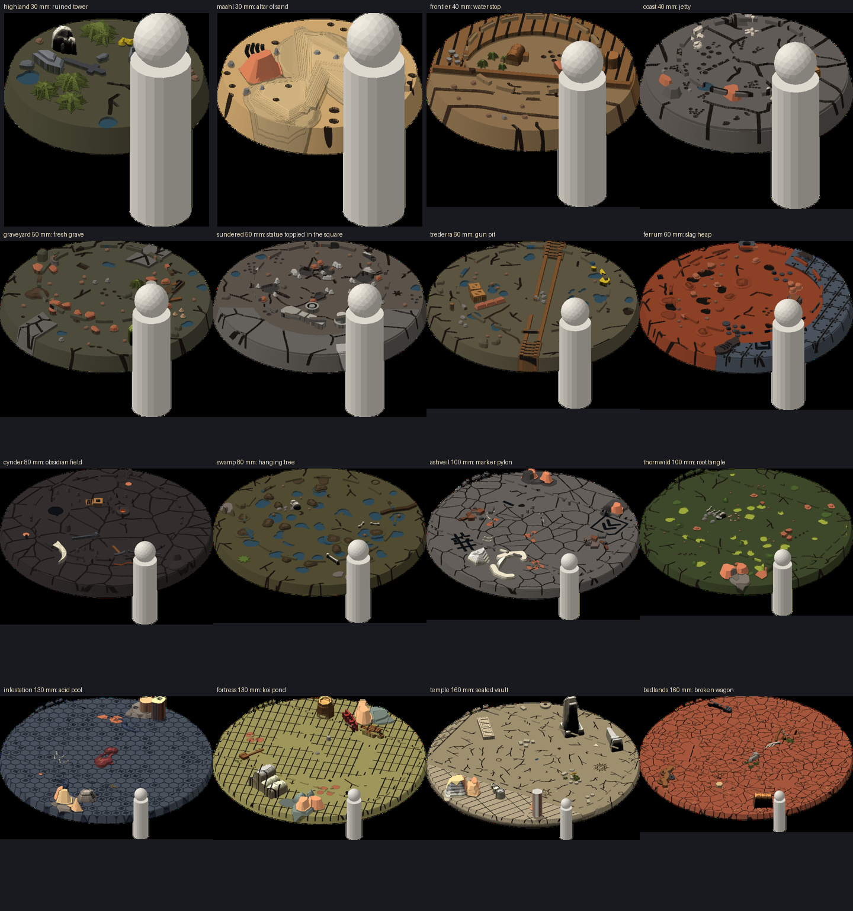

- **An icon for the exe**: a 1950s badge (the kit's title card) where it is big, BBB in front of a red disc where
  it is small (taskbar, title bar). `tools\make_icon.py` makes it.
- **A bigger pixel font in the window** (twice the size, on the art grid). The side panel, the buttons and the
  window's smallest size grew so every label fits.

- **Things on top are their real size, on every base (the new default).** A crate is 14 mm, a barrel 11 mm and a
  skull about 4 mm beside a 32 mm man (1:56, which fits 28 and 32 mm games), whatever the base size. The base is laid
  out at its own size, so cracks and paving keep their normal size; only the objects are true to the man. In the
  window: **Game scale** (how tall a man is: 32, 28 or 15 mm) and the slider **Size of things on top**, from Map (the
  old classic look, a whole small scene) through True to Chunky, with a picture under it of the base from above, the
  model's space, a crate, a barrel and a rock at that size and the man. Command line: `--obj 3` (true at 32 mm; 1 =
  the classic look, 4.5 = chunky) and `--figure 32` (the man's height for the picture); `settings.json`:
  `"object_size"` (default 3).
- **A bigger base is for a bigger model, and keeps room for it.** From 40 mm up the middle of the base is the model's
  space (web research on real bases: a model covers about 40 % of a 40-50 mm base, 50 % at 60-80 mm, 60 % from 90 mm
  up). It is a long box for a tank or other wide model (`--mini tracked`, wide, hover, quad, many, or the default
  from 90 mm up) and a disc for the rest. In it the ground is one level (no split level, no plate edge under the
  tracks); low things stay (cracks, plates, thin rubble), anything standing more than 2 mm is moved out to the side
  as a framing piece, or left out when there is no room. Loose debris and the bare-ground fill are fewer and larger
  on big bases (rubble chunks, not grit). The 3D picture marks the model's space with a dashed line floating over it.
  `"model_room"` in `settings.json` makes that space larger or smaller (default 1).
- **Big outcrops of stone or crystal frame a big base.** From 50 mm up, 1 to 3 outcrops stand at the rim, outside the
  model's space: a cluster of big rounded boulders in the style's own stone, or (about one time in three, where the
  style has a gem material) a cluster of pointed crystal spires growing from low rocks. The tallest piece stands at
  the back, toward the rim, and the rest step down toward the model. They grow with the base: about 8 mm across on a
  60 mm base (the ring round the model is narrow there), 15 to 20 mm across and as tall on 100 to 160 mm bases.
  `"outcrops": false` in `settings.json` turns them off.

- **One level under every object.** A small object on a floor plate stands fully on it, never half over a lower
  surface; on rough ground it has no more than 0.3 mm of step under it (was 1 mm). A centrepiece or second feature
  that is only partly on the plates or on raised ground (bedrock, dunes) gets the plates cut back round it, so it
  stands on one level (the tank across Ferrum's plate edge, the statue across two pavings). Joints between tiles do
  not count as a step.
- **The mine cart stands on its rails**, along the track, wherever a theme puts a cart by a track (mine, Cynder,
  Corridor, Ferrum, Badlands).
- **Readable details.** Parts of an object thinner than 0.5 mm are trimmed off (corners stay sharp); objects that are
  thin all over (spiky shrubs, roots, rope) are thickened a little first. Cuts narrower than 0.3 mm (plate seams,
  paving joints) are widened.
- **Themes that fit their style.** No more wooden boats in the grim-dark sci-fi styles: Targa's crashed pod,
  Infestation's cocooned wreck and Beast's swallowed wreck are a wrecked tank or truck (no anchor or chest in the
  flesh world), and so is the big-base wreck in Corridor, Urban, Targa, Trederra and Infestation. Vehicles are always
  metal. Swamp's hunters' hide no longer gets a rowboat.
- **A check of every base** (`BBB_AUDIT=<file>` in the environment): one line per laid-out base counting objects that
  straddle two levels, cut into each other, are too thin or too low, cuts too narrow, objects in water and very tall
  ones. Over 25 styles x 4 sizes x 2 seeds it took straddles from 448 to about 150, thin parts from 1124 to 10 and
  narrow cuts from 2600 to about 430.


- **Wrecked tanks and trucks.** The grim-dark sci-fi styles no longer show a wrecked boat. Ashveil's *buried
  transport*, Ferrum's *fallen work-machine* and Thornwild's *overgrown wreck*, and the big-base wreck landmark in
  Ashveil, Ferrum, Sundered and Thornwild, are now a wrecked tank or truck. A tank has track runs with cut links,
  one track broken, an engine grille and a turret that is still on or blown off beside it. A truck has tyres, a
  bonnet, a cab and a flatbed with torn rails. All metal, with no overhangs.
- **Join into one solid (Manifold).** With *Allow overhangs* on, a second switch appears: *Join into one solid*
  (on by default). The objects that may overhang are then joined into the base with the Manifold library, so the
  STL is one clean solid instead of the base with each object as its own shell sunk into it. Any piece that would
  hang in the air, touching nothing, is left out, and the thin slivers a join can leave are cleaned off. The print
  check expects one solid again. Off: the old way, each object its own shell for the slicer to join.
  Command line: `bbb_kit.exe --job build ... --supports on --join on|off`; `settings.json`: `"supports_join"`.
- **A MANIFOLD row in the window**, one switch per job Manifold does for each base:
  - **Smaller files** (on): the flat parts of each base are drawn with fewer, bigger triangles; the shape moves no
    more than 0.005 mm. STLs come out 20 to 38% smaller and load faster; it costs about 0.1 s a base.
  - **Strict check** (on): the print check also asks Manifold whether the base is a valid closed solid, and builds a
    fresh variant if it is not.
  Command line: `--smaller on|off`, `--strict on|off`; `settings.json`: `"smaller_files"`, `"strict_check"`.
- **Finer steps on tall rounded objects.** A barrel, dome or log is built as stacked slices; the exe now makes them
  0.1 mm high at most (up to 60 per object, was 18), finer than a print layer. `settings.json`:
  `"detail_step_mm"` (0 = the old steps). Bases cost no more time and about 1 to 13% more triangles.
- From 2.1 the exe's bases are no longer the same byte for byte as the Python kit's (the finer steps, the join and the
  vehicles); the Python kit is unchanged and still has the boat.
- Still being tested, so not in the window yet: *smooth details* (rounded objects as true smooth shapes) and *organic
  rocks* (rocks as lumpy natural shapes), both joined into the base. They are off unless you ask for them on the command
  line: `--smooth on`, `--rocks on`.

## What is new in 2.0.1

- **Supports on keeps every round bar.** About 7% of ribs, bones, roots and horns were dropped from bases built with
  supports on (the arch's far end rounded a hair below zero, which made its height invalid). They are kept now.

## What is new in 2.0: one exe, all in C, nothing to install

- **`bbb_kit.exe` is the whole kit.** Every part of it is written again in C and built into the one exe: the styles
  and themes, the layouts, every detail, the height field, the mesh, the checks, the pictures and the report. It
  never starts Python, needs nothing installed, carries the model packs inside it and runs from any folder: copy
  `bbb_kit.exe` anywhere and start it. What it makes goes into `out\` beside it.
- **The same bases as the Python kit, byte for byte.** Each C part was checked against the Python it replaces, call
  by call (millions of cases in all), and then whole jobs: all 25 styles at 30, 60, 100 mm and 90x52, the classic
  look and figure scale, with supports off and on. The STL files and pictures come out identical. The Python kit
  stays in the folder and still works as before.
- **About 2 to 3 times faster per base**, and the choices are drawn on all but one of your cores.
- **A colour view of the finished base.** The **COLOUR** switch beside a built base shows its 3D picture coloured as
  its 2D drawing, so you can see each part is where the drawing put it. It is saved too, as `_3d_color.png`.
- **Six new styles** (sundered, ashveil, ferrum, thornwild, obelis, blight), five themes each, every base size: 25
  styles and 125 themes in all.
- **Small bases keep their detail.** Under 50 mm the kit always uses the classic look (a whole small scene), because
  objects at true figure scale are too small to show there. Big bases keep detail on the top: rough ground stays off
  the floors.
- **Errors say exactly what went wrong.** Every error the kit catches and works round is written to
  `out\kit_errors.log` with the base, the step, the file and line; the report has an "errors caught" column.
- **Supports on** (true 3D solids for overhanging objects) works in the exe too.
- **Licences:** `bbb_kit.exe` contains the GEOS geometry library and parts written after Pillow, trimesh, CPython and
  others; see [THIRD_PARTY_NOTICES.md](THIRD_PARTY_NOTICES.md) and the `licenses` folder.

## What is new in 1.6: watch it build, rocks in C, faster choices

- **Watch it build.** A strip under the window's top shows the kit's own work: a bar for each of its threads that is
  working (other programs are not counted, idle threads are not shown) with how many of the PC's cores that is, and
  how much of the video card is in use. Read twice a second. Three views, picked at the right of the strip:
  - **Small:** each building card says in words what is being done, with a time-left bar.
  - **Live card:** the building card shows the base taking shape. While the scene is laid out, the pieces appear as
    they are placed. Then the base's drawing from above appears, with the height field's tiles over it, each one dimmed
    until a thread has finished it.
  - **Big view:** the base being built fills the middle, with what is being done, the time left and its thread count
    beside it, and every card of the build small in a row below. When the base is done it shrinks back into its card
    and the next one building takes its place. Click a building card to watch that one.
  - **Parts** gives each piece its own switch: Core bars, Video card meter, Base taking shape, Time left and Rows over
    time (one row per base, coloured by what it was doing when).
  - Time left comes from your earlier builds of the same style, size and detail (`out\live_times.txt`, written as
    bases finish). It never goes back up. Until there is a build to go by, it says "estimating ...".
  - The build writes small progress notes into `out\.live` only while the window watches. The bases come out byte
    for byte the same with or without them, and they cost about 1% of the build time.
- **Oval bases get wide cards**, with their pictures cropped to the oval and their 3D pictures drawn wider.
- **The small rocks are made in C** (`cport\scatter.c`, `cstone.py`): the rock clusters, and the pass that keeps the
  top from being bare, which makes most of them. A 30 mm graveyard choice at 32 mm figure scale took 71 s, now 17 s.
  The very same rocks: the outline sums are exact copies of the ones the shape library (GEOS 3.14.1) makes, checked
  on 2 million random rocks and on whole scenes, byte for byte. `"c_rocks": false` in `settings.json` (or
  `KIT_CROCKS=0`) makes them in Python again.
- **Choices are drawn by up to every core but one at once** (it was 8).
- **Fix: a detail cut into the top no longer slices a taller piece placed before it** (the tank tops on mine bases):
  a cut now only lowers what lies between its bottom and its top.
- **The run says what it really used:** the engine line names the mesher and the picture maker, and the report has
  a "made by" column.

## What is new in 1.5: sharper objects, ovals, a figure for scale, real ground

- **The classic look is the default again.** Every base is a whole small scene, its things about a third of true
  size, as up to 1.3: on small bases the true figure scale of 1.4 showed only a bare part of a scene. True figure
  scale is still there: choose 32 mm, 28 mm or 15 mm in the window's row "Objects sized for figures of" (it is
  called "classic" there), or `--scale 3` on the command line. Everything below about real ground and the figure
  post is part of that figure scale.
- **Fewer things on top, if you want.** `--objects 0.33` (or `"objects_amount"` in `settings.json`) keeps a third
  of the things that stand on a base; the ground itself is never cut. The default is 1, all of them.
- **Ground shape from 50 mm up** at figure scale (it was 90 mm and up): lower on smaller bases, about 7 mm at the
  edge of a 60 mm base and 5.5 mm on a 50 mm one, 12 mm from 90 mm up.
- **Faster: two SPEED switches in the window**, both on by default.
  - **CPU threads:** the base's height field and its mesh are made in C, inside `bbb_kit.exe`, on as many CPU threads as the base needs (about one per 8 ground tiles, up to every thread the PC has). For
    those two steps that is about 3 times faster (a 160 mm temple: 7.5 s down to 2.5 s; the whole build 28 s down to
    20 s). The surface is the same as with the switch off. With one thread the C code gives the very same STL as
    Python, byte for byte (checked on 7 bases). Off: one core, the proven path.
  - **Video card:** the 3D pictures are drawn by the video card (Direct3D 11) instead of by Python: 0.3 s instead of
    4.7 s for a 160 mm base. Without a usable card, Windows' own software renderer draws them. Off: Python.
  - In `settings.json`: `"cpu_threads"` and `"video_card"` (true/false). The window's switches win over them.

- **117 objects redrawn for their true size.** At the 32 mm figure scale the biggest things (carts, boats, tents,
  machines, ruins, logs) are built three times larger than they were drawn, and some looked plain. They now have
  planks, rivets, ribs, ropes and broken edges, each kept to its real footprint.
- **Oval bases**: 60x35.5, 75x42, 90x52, 105x70, 120x92, 150x95 and 170x109 mm, in the window's second size row or
  with `--size 90x52`. Magnet pockets run along the long axis. See "Oval bases" below.
- **A figure for scale in the window.** Each picture of a built base has a plain post beside it, as tall as the
  figure size you chose (32 mm, 28 mm, 15 mm), so you can see at once how big things are.
- **Real ground on big bases** (90 mm and up). The ring round the clear middle now rises and falls with the style:
  mesas and gullies in the badlands, dunes, snow drifts and crevasses, mud pools with islands, rubble heaps and shell
  craters, heaved deck plates, root mats, grave mounds. Low near the miniature, up to 12 mm high at the edge, with
  nothing overhanging. Bases under 90 mm are unchanged.

Known limits: on big bases the raised ground sits mostly in the outer ring, so some read like a shallow bowl; the
slopes show small steps; cuts can only go about 1 mm deep (the magnet pockets are below), so gullies and pools get
raised banks instead; floor styles (corridor, dungeon, urban, fortress) change the least.

## What is new in 1.4: objects at the miniature's scale

Until now the kit built a small landscape: beside a 32 mm figure everything was about a third of true size (a rail
track 5 mm wide, a barrel 4 mm across), and some things grew with the base while others did not. A tank on a large
base would have looked the size of an airship.

- **Objects are now true to the miniature**, and the same size on every base. A barrel is about 11 mm across beside
  a 32 mm figure, a chest 16 mm long, a rail track 9 to 10 mm wide.
- **A small base holds what fits**: a few things, or a part of one. A large base holds a whole scene. The scene is
  laid out small and built larger, so what does not fit is cut off at the edge like any real scenic base.
- **The miniature can always stand.** Whatever the scale, its standing spots are on the base, flat, and level with
  the ground they lie on.
- **You choose the figure size**: 32 mm, 28 mm or 15 mm; "classic" is the small-landscape look (the default
  again since 1.5).
  In the window it is the row "Objects sized for figures of"; on the command line `--scale 3` (32 mm), `2.6` (28 mm),
  `1.4` (15 mm) or `1` (classic, the default); in `settings.json` it is `"scenery_scale"`.
  **Bases under 50 mm always get the classic look**, with all their detail on top, whatever figure size is chosen:
  at figure scale a 30 mm base showed only a bare part of a scene. `"figure_scale_from_mm"` in `settings.json`
  moves that limit (default 50).
- **Each object has its own real size** (695 objects, a size in metres for each, in `scale/real.json`): a skull is
  about 4 mm, a barrel 11 mm across, a chest 14 mm, a rowing boat 54 mm. Nothing prints under 3 mm, so a coin or a
  key is shown a little larger than life.
- **A bigger base carries a bigger model, so it only gets big things.** Tabletop miniatures share one scale for
  every model; a 32 mm base carries a trooper, a 160 mm base a war machine 150 to 175 mm tall. Anything shorter than a
  twelfth of the base is left out: a 160 mm base shows carts, chests, boats and logs, not bottles and skulls.
- **Ground grows with the base.** Rocks, drifts, craters and growths (things with no fixed size) are about 0.8 times
  as drawn on a 30 mm base and 2.2 times on a 160 mm base: stones for a trooper, boulders for a war machine.
- **No landmark in the middle.** At this scale a base is a patch of ground: the miniature stands in the middle, the
  middle 45 % is kept clear (`"clear_middle"` in `settings.json`), and things lie round the edge.
- The ground (paving, planks, cracks) is enlarged with everything else, so paving stones are larger too.
- Nothing stands more than 25 mm above the deck, and no cut goes nearer than 2.9 mm to the bottom (the magnet
  pockets are 2.1 mm deep).

Known limits of this first version: objects were drawn for the small size, so some are plain when built three times
larger; on bases under 90 mm the scene's middle part is what you get, and the plan file's "stand at" position is in
the layout's own millimetres.

## What is new in 1.3

- **279 new details made from public-domain 3D models, in all 19 styles** (there were 24, in one style). A chest, a
  key ring, a padlock, a skull, a horseshoe, a sheriff's star, a boot, a spanner, a valve wheel, a fire hydrant, a
  traffic cone, a wagon wheel, a ship's wheel, standing stones, a throwing star and many more. Every one was looked
  at on a close-up sheet; the ones that did not read as the real thing were left out.
- **Five styles redrawn by hand**, because no model fits them: infestation, cynder, trederra, maahl and targa.
  Blobs and boxes became a dead crawler with jointed legs, a shed husk, basalt columns, a forge bellows, a tin
  helmet, a gas mask, sandbags, rats, a buried stone head, a scarab, a sled, an ice-fishing hole. 85 details redrawn,
  12 new.
- **More models**, all public domain (CC0). The first
  run fetches 25 packs, about 92 MB (it was 9 MB). The window does this too now, and says so at the top
  while it does.
- **Faster.** Details from models are sliced once instead of at every try. A 100 mm base with many of them builds in
  about half a minute.
- **Fixed: the window said "not built" for a base that was built.** When two builds finished at the same moment
  their lines ran together and one was missed. (The example in the 1.2 README showed this: all five were built.)
- **Fixed: a base could come out flat.** Once in a while one bad outline near the rim was read as a cut hundreds of
  millimetres wide and planed every object off the base, and the base still passed. The drawing saved beside the STL
  showed it at once (a full drawing, an empty base). The outline is now read correctly, an oversized cut is refused,
  and a new check compares the height of the finished mesh with the design.
- **Fixed:** an error on some large bases ("complex number") that came from one shape's end width.

## What is new in 1.2

- **A window: `bbb_kit.exe`.** Choose style, size, detail and miniature with a click, see the designs as pictures, tick
  the ones you want and press Build. Python runs hidden in the background. See [The window](#the-window-bbb_kitexe).
- **Pick before you build.** The kit draws up to 20 designs in about half a minute. Only the ones you tick are built.
- **1 to 20 bases at a time**, typed into a number box, or "build that many straight away" without picking.
- **Sixteen base sizes in the window**, from 20 to 160 mm (20, 25, 28, 28.5, 30, 32, 40, 50, 60, 65, 70, 80, 90, 100,
  130, 160).
- **The 2D drawing is saved with every base**, beside the STL, so you can check the finished base against what was laid
  out. See [The drawing and the finished base](#the-drawing-and-the-finished-base).
- **One folder for what you picked**: every base you build from the window is copied to `out\picked_<date>_<time>`,
  named by style, size and theme, with its STL, 3D picture (grey and colour), 2D drawing and plan.
- **130 and 160 mm bases have five magnet pockets** (four round, one in the middle).
- **A help page** in the window: press `?` or F1, or the Help button.

## The window (`bbb_kit.exe`)

Start `bbb_kit.exe` (it is in the release zip; its source is in `gui\` and `cport\`). It needs nothing else: no
Python, no libraries, no download. It runs from any folder and keeps what it makes in `out\` beside it.

**1. Choose, and look at the designs.** Style, size, detail, miniature and the figure size the objects are made for
are one click each on the left; the number box takes 1 to 20. "Show choices" draws that many designs. Click the ones you want: a teal tick marks them.

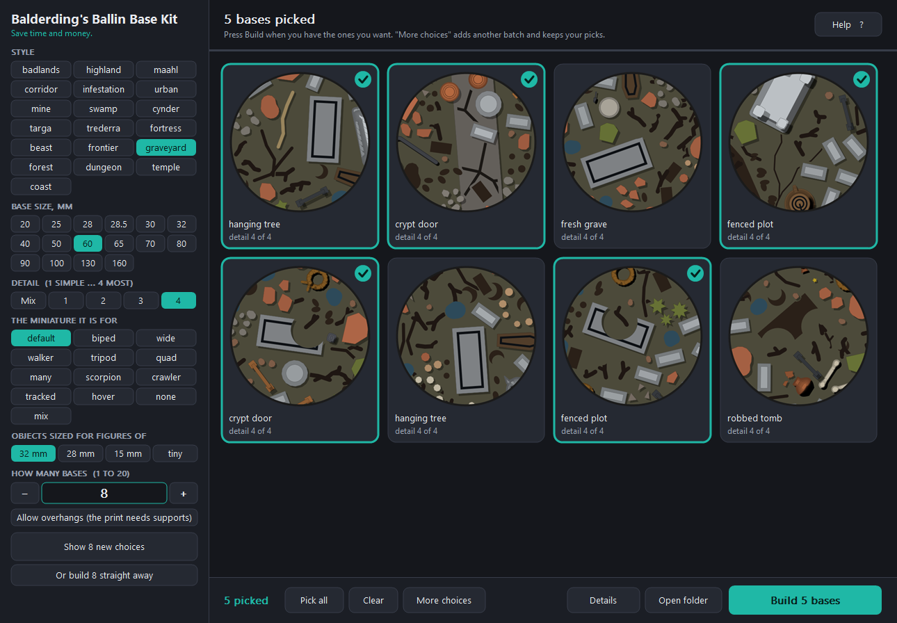

**2. Build.** The picked bases are built several at a time. Each is made as an STL and put through the print check;
the line at the top says how far it is.

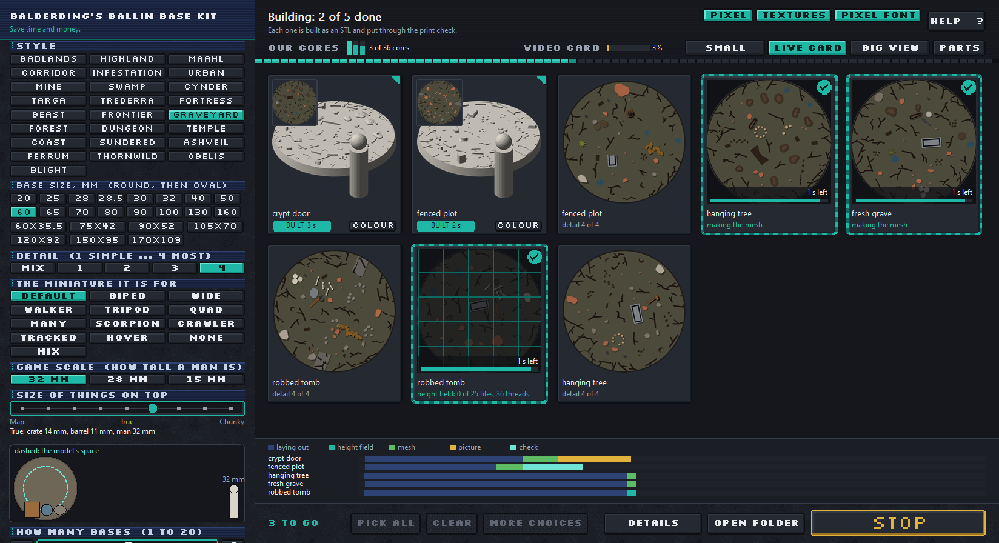

**3. What you get.** A built card shows the finished base in 3D, with its 2D drawing small in the corner to check one
against the other. Teal means built and checked. Gold means look here: a picked design that failed the print check
was either replaced by a fresh variant or, after four tries, not built, and the window says so instead of handing
over a bad file. Click a built card to see its STL file; "Open folder" opens the folder with all of them.
The **COLOUR** switch beside a built base shows the same 3D picture coloured as its 2D drawing (the same
colours, taken from straight above), so you can see each part is where the drawing put it. Click it again for the
plain grey picture. Bases built after you switch it on start in colour too.

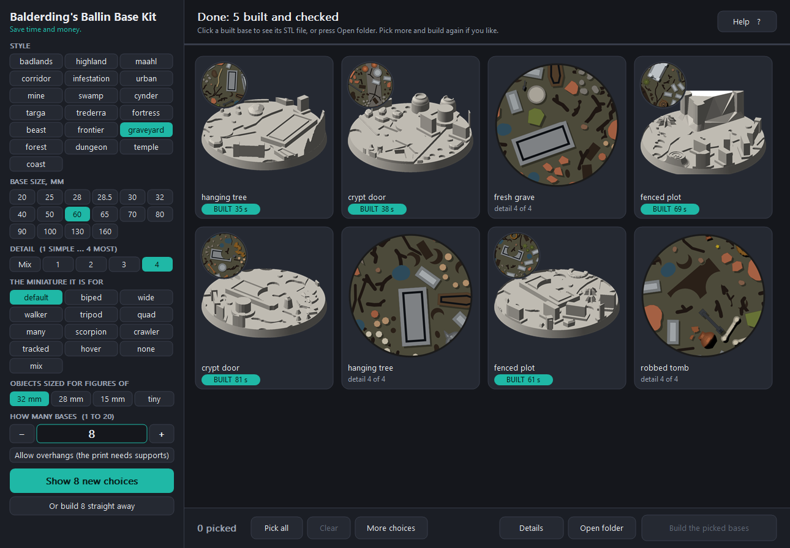

**Help** is on `?`, F1 or the button at the top right.

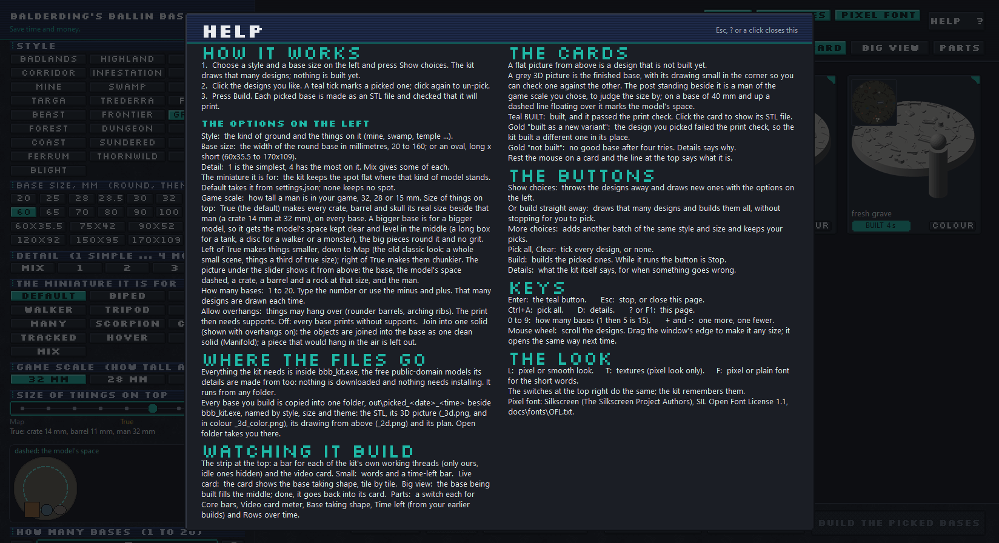

Good to know:

- "More choices" adds another batch of the same style and size and keeps your picks.
- "Or build N straight away" draws N designs and builds them all without stopping.
- A picked design that fails the print check is replaced by a fresh variant (gold label "built as a new variant");
  its drawing in the folder is the drawing of the variant, so drawing and STL always match.
- The window is resizable and remembers its size and your last choices (`out\bbb_kit.ini`).
- Keys: Enter = the teal button, Esc = stop, Ctrl+A = pick all, D = details, 0-9 = how many, `?` = help.
- The window runs the kit's job in its own process (the same code as `bbb_kit.exe --job build ...`, which prints
  one JSON record per event: choice, start, built, done). It starts copies of itself as helpers, one per core.
- To build the exe yourself: `cport\geos_static\build_geos.cmd` and `cport\manifold_static\build_manifold.cmd`
  once (GEOS 3.14.1 and Manifold 3.5.4 as static libraries), then `gui\build.cmd` (clang with the MinGW headers).
  The exe imports only Windows' own DLLs.

## The drawing and the finished base

Every base is saved with the drawing the kit laid out (`<name>_2d.png`) beside its STL and its 3D picture. Below:
three bases from the run shown above. Left the drawing, middle the finished STL seen from straight above (the same
way up, so you can find each thing), right the same STL from the side. Colours in the drawing only tell the kinds of
thing apart; the print is one colour.

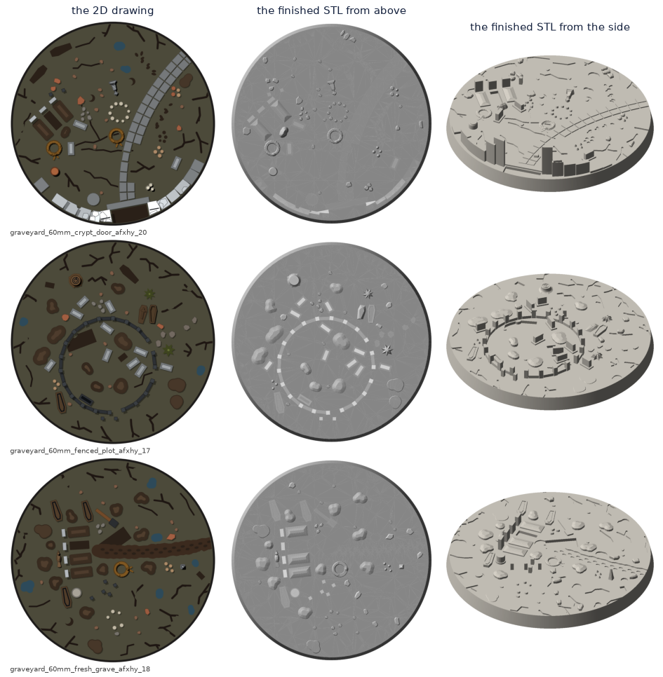

`python tools\make_compare.py <folder with built bases> out.png` makes this picture for any run.

## What the bases look like

Two bases of every size, each in a style drawn at random, exactly as the kit made them (pictures of the finished
STL files; `python tools\make_examples.py` makes a fresh set).

<!-- EXAMPLES -->
| Size | | |
|---|---|---|
| **30 mm** | 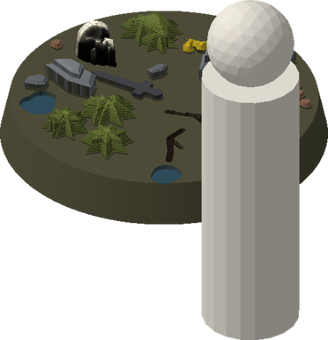<br>highland: "ruined tower" | 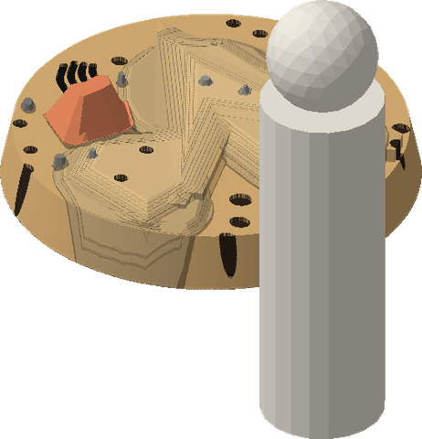<br>maahl: "altar of sand" |
| **40 mm** | 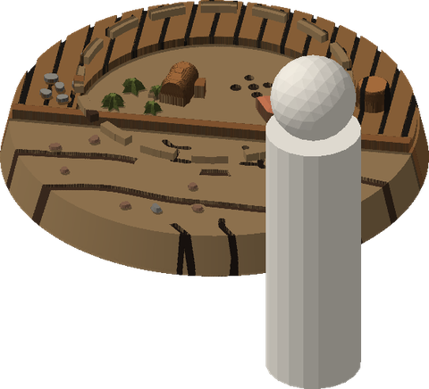<br>frontier: "water stop" | 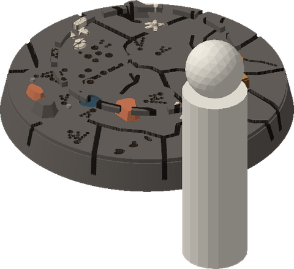<br>coast: "jetty" |
| **50 mm** | 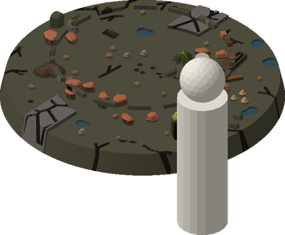<br>graveyard: "fresh grave" | 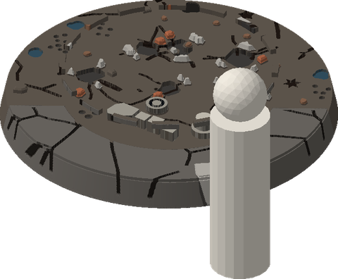<br>sundered: "statue toppled in the square" |
| **60 mm** | 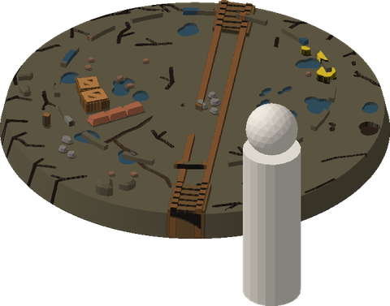<br>trederra: "gun pit" | 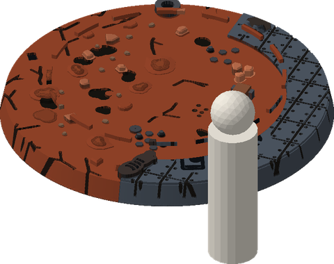<br>ferrum: "slag heap" |
| **80 mm** | 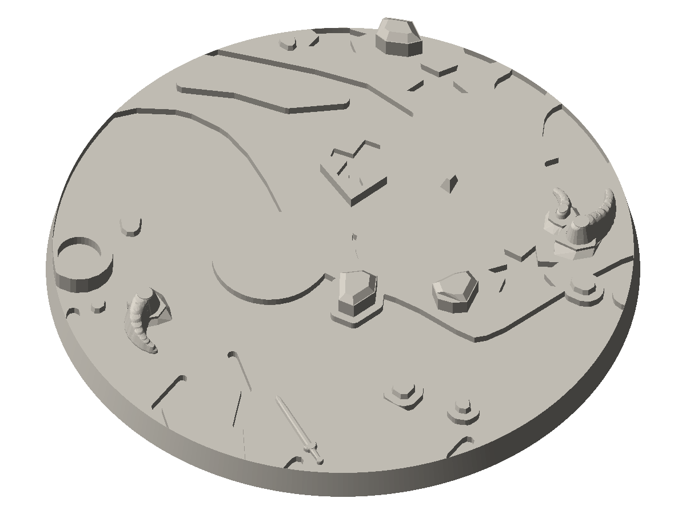<br>cynder: "obsidian field" | 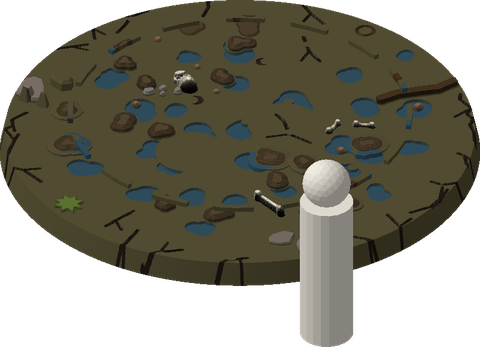<br>swamp: "hanging tree" |
| **100 mm** | 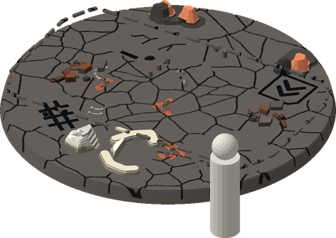<br>ashveil: "marker pylon" | 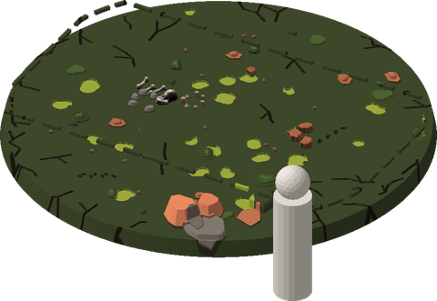<br>thornwild: "root tangle" |
| **130 mm** | 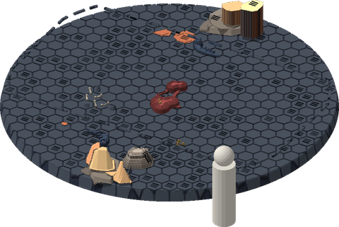<br>infestation: "acid pool" | 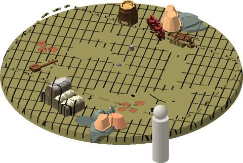<br>fortress: "koi pond" |
| **160 mm** | 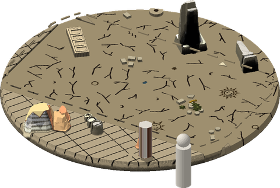<br>temple: "sealed vault" | 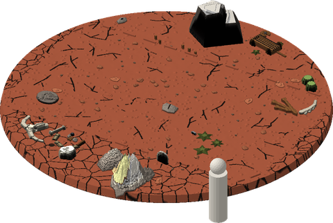<br>badlands: "broken wagon" |
<!-- /EXAMPLES -->

**Every base is one place.** A base is not a pile of objects: it has a subject (a mine shaft, a wreck, a shrine), a
path that leads to it or past it, the things that belong to them placed where they belong, clutter where it would
gather, and open ground in front of the subject for the miniature to stand on. Each style has 5 named themes
("tunnel mouth", "boat landing", "robbed tomb"...), 95 in all; see [Scenes and themes](#scenes-and-themes). A local
AI model can write new themes of its own; see [The designer model](#the-designer-model-optional). That is optional.

Each base: round, 4 mm tall with a 12 degree sloped edge, 6 x 2 mm magnet pockets underneath (one to five, by
size), and detail on top with no height limit: a gate, a statue or a ruin stands as tall as its scene says. Each part
stays no taller than 3 times its own thickness, so it prints and does not snap off.

The kit builds the STL itself, in Python, in a few seconds per base. No CAD program is needed.

25 styles:

| Theme | What it is |
|---|---|
| `badlands` | Cracked desert, washes, sandstone |
| `highland` | Slate outcrops, grass, heather |
| `maahl` | Dunes, crystals, ruins |
| `corridor` | Spaceship deck: plates, grates, pipes |
| `infestation` | Deck overrun by alien growth |
| `urban` | Streets: curbs, paving, rubble |
| `mine` | 1800s mine: timbers, track, ore |
| `swamp` | Swamps of Jargono: mud, pools, roots, reeds, temple stones |
| `cynder` | Caverns of Cynder: basalt, lava, obsidian |
| `targa` | Targa Plateau: frozen alien city, ice, snow |
| `trederra` | Trederra: trench duckboards, sandbags, shell holes, wire |
| `fortress` | Forbidden Fortress: plank walkways, tatami, lanterns |
| `beast` | Belly of the Beast: flesh, veins, bile, teeth |
| `frontier` | Old West town: boardwalk, wagon ruts, barrels |
| `graveyard` | Headstones, coffins, open graves, fence |
| `forest` | Roots, stumps, mushrooms, streams |
| `dungeon` | Flagstones, drains, trapdoors, chains |
| `temple` | Ancient temple: paving, columns, steps, glyphs |
| `coast` | Rock shelves, tide pools, shells, driftwood |
| `sundered` | Sundered City: a gothic city shelled to rubble, broken columns, arched windows, fallen statues |
| `ashveil` | Ashveil Wastes: grey ash plains, half-buried wrecks, pipelines, bones, scrap |
| `ferrum` | Ferrum Works: a red, rusted factory world, deck plates, gears, cables, vents, slag |
| `thornwild` | Thornwild: a deadly alien jungle, giant roots, maw flowers, spore pods, glowing fungi |
| `obelis` | Obelis Tombs: an ancient alien tomb world, black monoliths, glyph slabs, pylons, caskets |
| `blight` | The Blight: corrupted ground, twisted thorns, bone heaps, boiling pools, rune circles |


## 1. What you need

For the window (`bbb_kit.exe`): nothing. The rest of this part is for the Python kit (`run_set.py`, `bbb_kit.cmd`).

- **Python 3.10 or newer** (tested on 3.15).
- These Python libraries (shapely 2.1 or newer). Install them once:

```
python -m pip install --user shapely numpy matplotlib trimesh rtree networkx
```

If `pip` is blocked on your machine, the `python -m pip ...` form above usually still works.


## 2. Set it up (once)

1. Download `bbb_kit_<version>.zip` from the [Releases page](https://github.com/Balderding/base_kit/releases) and unzip it anywhere.
2. Open a terminal (PowerShell on Windows) in the `bbb_kit` folder.

When you run a build the kit stops with a plain message if a Python library is missing or too old.

### The model packs (inside the exe; fetched on the Python kit's first run)

About 300 details (chests, skulls, tools, bottles, wheels, gravestones ...) are made from ready-made low-poly 3D
models. They are free and in the public domain (Creative Commons Zero, CC0: anyone may use them for any purpose).
`bbb_kit.exe` carries the models it uses inside it, so the window downloads nothing.

The first time you run `bbb_kit.cmd` (the Python kit) the kit says which packs it is about to fetch, from which pages
and how big they are, and then downloads them into `models\<pack>`: 25 packs, about 92 MB. It happens
once, nothing else is downloaded, and nothing is sent anywhere. A pack whose licence text does not say CC0 is not
unpacked or used. `python run_set.py ...` never downloads by itself; it only tells you if packs are missing.

- To do it yourself: `python tools\get_models.py` (`--list` shows what is here; `--all` fetches every pack in
  `models\packs.json`, about 750 MB unpacked, for trying more models).
- By hand: `python tools\get_models.py --list` shows the pages; the fetch prints what to do for a pack that fails.
- To stop the download: `"models_download": false` in `settings.json` (or `bbb_kit.cmd --models off`). A pack that
  is not there only means its details are left out; everything else works the same.


## 3. Build bases

```
python run_set.py <style> <how many> [--size MM] [--detail 1|2|3|4|mix]
```

You say **which theme**, **how many bases**, and optionally **what size** and **how detailed**:

| Command | What you get |
|---|---|
| `python run_set.py urban 20` | 20 new urban bases, an even mix of the four detail levels |
| `python run_set.py mine 50 --detail 4` | 50 new mine bases, all at the most detailed level |
| `python run_set.py badlands 10 --detail 1` | 10 new badlands bases, all simple |
| `python run_set.py all 100` | 100 of every theme (1,900 bases) |
| `python run_set.py urban 10 --size 40` | 10 new 40 mm urban bases |
| `python run_set.py swamp 5 --size 60 --detail 4` | 5 new 60 mm swamp bases, most detailed |

Detail levels:

| `--detail` | What it means |
|---|---|
| `1` | Simplest: the basic layout and a few extras |
| `2` | More features and extras |
| `3` | Detailed |
| `4` | Most detailed |
| `mix` (default) | An even mix: a quarter of the bases at each level |

### Base size

`--size` is the diameter in millimetres. The default is 30. Any size from 20 to 200 works; these are the common
round sizes:

| Size (mm) | Commonly used for |
|---|---|
| 25, 28, 28.5 | Small infantry |
| 30 | Shadows of Brimstone heroes and small enemies |
| 32 | Standard infantry |
| 40 | Large infantry, elites, characters |
| 50 | Very large infantry, small walkers and cavalry |
| 60, 65, 70 | Monsters, small vehicles |
| 80, 90, 100 | Large monsters, big walkers |
| 130, 160 | The largest models |

An oval base is long x short: `--size 90x52` (or `90x52mm`). The common ovals:

| Oval (mm) | Commonly used for |
|---|---|
| 60x35.5 | Cavalry, bikes |
| 75x42 | Large cavalry |
| 90x52 | Monstrous cavalry, chariots |
| 105x70 | Large monsters, flyers |
| 120x92 | Big monsters, small vehicles |
| 150x95, 170x109 | Very large flyers, the largest models |

How size works:
- The base, its sloped edge and all the checks use the size you ask for. One 6 x 2 mm magnet pocket sits in the centre.
- Bigger bases get **more** detail, not just bigger detail: extra pieces (rocks, crates, bones...) stay the same real
  size and there are more of them.
- The ground itself (paving, planks, plates, cracks, pools) also stays the same real size in every theme: a bigger
  base simply shows more of it.
- Big bases take longer: a few seconds at 30 to 100 mm, up to about a minute at 160 mm (see the times below).
  The time limit per base grows with the size.
- Square bases are not supported yet. Ovals are: see "Oval bases" below.

Every base is new, whatever you ask for. Files are numbered in the order asked: `urban_30mm_001.stl`, `urban_30mm_002.stl`...
The report lists each base's detail level.

Other options:

| Option | What it does |
|---|---|
| `-q` | Quiet: only one OK / FLAG line per base |
| `--workers 3` | Build 3 bases at the same time (default "auto": a third of the CPU cores, 2 to 12) |
| `--seed abc12` | Rebuild exactly the bases of an earlier run: same theme, count and detail, plus its seed (printed at the start of every run) |
| `--theme "tunnel mouth"` | Every base gets this theme of the style. A wrong name prints the style's themes |
| `--plan file.json` | Build from a scene plan file (see "Editing a scene" below) |
| `--scenes off` | The old behaviour: details placed wherever there is room, no theme |
| `--designer on` | A local AI model writes the scene plans (see "The designer model") |

Expect 2 to 5 seconds per base at 30 and 60 mm, about 8 seconds at 100 mm and 20 to 50 seconds at 160 mm.


## 4. What you get

Each run makes its own folder, so nothing is ever overwritten:

```
out\run_<date>_<time>_<seed>\
    urban\urban_30mm_001.stl         the base, ready for your slicer
    urban\urban_30mm_001_iso.png     a preview picture (3D)
    urban\urban_30mm_001_2d.png      the drawing of the same base from above, to check the 3D against ("drawing_2d" in settings.json)
    urban\urban_30mm_001_plan.json   its scene plan: theme, subject, path, objects (edit it and rebuild with --plan)
    urban\failed\               STLs of attempts that failed a check (kept for reference)
    urban_report.csv            one row per attempt: result, build time, failure reason, what was dropped, theme, plan
    plans.json                  only with --designer on: the plans the model wrote for this run
    urban_sheet.png             one picture sheet of the whole set
out\built_signatures.txt        fingerprint of every base ever built (keeps bases from repeating; keep this file)
```

What the terminal lines mean:

- `OK urban_30mm_007 24 s  plan: table "tram stop"` - built and passed every check; its theme is "tram stop" from
  the built-in table. `plan: designer "..."` means the model wrote it; `(2 fixes)` means the kit repaired two things in
  the model's plan; `plan: designer failed (timeout), table "..."` means the model did not answer and a built-in
  theme was used instead.
- `OK ... (fresh variant after: ...)` - the first attempt failed for the reason shown, so a different base was built
  in its place. Normal; nothing to do.
- `OK ... dropped: rubble` - the base is fine but one small piece could not be added and was left off.
- `FLAG urban_30mm_007 failed 4 times: ...` - no good base after every attempt. Rare. The reasons are in the report.


## 5. The checks every base must pass

1. **Printable**: the STL is one closed solid (no open edges, no loose pieces), exactly the size asked for, the magnet
   pocket is open, and nothing is taller than the limit.
2. **Not a repeat**: its fingerprint has never been built before (`built_signatures.txt`).
3. **Different enough**: it is compared with the last 10 bases of its theme. If less than 15 % of its detail
   differs from any of them it is rejected and rebuilt.
4. **As tall as designed**: if the finished mesh is less than half as high as the tallest thing in the design, the
   objects were lost on the way and the base is rejected.

A base that fails any check is rebuilt as a new variant, up to 4 attempts.

### Measuring how different your bases are

```
python compare_bases.py out
```

compares every base with the previous 10 of its theme and with all the others, prints a summary per theme and
writes `compare_report.csv`. The score is the percentage of the detailed area that differs by more than 0.3 mm,
using the best of 72 rotations (a round base turned by hand is still the same base). The same base turned scores
1-4 %; unrelated bases usually score 30-80 %. Themes with a repeating floor (corridor, infestation, urban) score
lower because the floor pattern is shared by design.


## 6. Settings (settings.json)

Everything is optional.
The old Python kit's own keys (the SolidCraft path, its merge and chamfer timings, `engine`, `models_download`) are in `settings_python.json`; bbb_kit.exe does not use them.

| Setting | Default | What it does |
|---|---|---|
| `scenes` | true | Every base is one place with a theme. false = details wherever there is room (the kit before scenes) |
| `designer` | off | The local AI model that can write scene plans; see "The designer model" for its settings |
| `big_base_height_factor` | 1.5 | Bases of 60 mm and up may carry detail this much taller (3.3 mm x 1.5) |
| `out_folder` | `out` | Where runs are saved |
| `workers` | "auto" | Bases built at the same time ("auto" = a third of the CPU cores, 2 to 12; or a number) |
| `cpu_threads` | true | One base's height field and mesh on as many CPU threads as it needs, up to every thread the PC has, in C (a number = that many threads; false = one core, the proven path). The window's CPU threads switch wins |
| `detail_step_mm` | 0.1 | The highest step on a rounded object (barrel, dome, log), in mm: smaller is smoother. 0 = the Python kit's steps (up to 18 per object) |
| `smaller_files` | true | Each STL simplified by Manifold (flat parts in fewer triangles, the shape moves no more than `smaller_files_mm`, 0.005). The window's Smaller files switch wins |
| `strict_check` | true | The print check also runs Manifold's own test of a valid closed solid. The window's Strict check switch wins |
| `plate_cover` | 0.97 | A small object on floor plates must be on them for at least this share of its area (else it is not placed there). 0 = off |
| `plate_cover_big` | 0.9 | The same for a centrepiece or second feature: below it, the plates are cut back round it. 0 = off |
| `max_step_mm` | 0.3 | The most step allowed under an object on rough ground (was 1.0) |
| `min_part_mm` | 0.5 | Object parts thinner than this are trimmed (or the object thickened first). 0 = off |
| `min_cut_mm` | 0.3 | Cuts narrower than this are widened. 0 = off |
| `cart_on_track` | true | A cart by a track stands on its rails |
| `prop_sink_mm` | 0.4 | Things standing on the ground sit in it: their top is this much lower (at most 15 % of their height). 0 = off |
| `story_direction` | true | On a base with a subject (a wreck, a ruin, a crater), the debris lies along lines out from it, as if thrown or fallen from it |
| `style_strength` | 1 | How bold the style is, 0.25 to 2.5: deeper cracks, bolder rocks, coarser ground grain (catch washes and drybrushing). `--strength` and the window's Style strength row win |
| `printer` | `fdm` | The printer the bases are for: `fdm` (filament) or `resin`. FDM: a coarser ground grain (`ground_grain_fdm_mm`, 0.25) deep enough to print in layers, no detail under 3 mm. Resin: the finer grain (`ground_grain_mm`, 0.12), details down to 2 mm. `--printer` and the window's Printer row win |
| `ground_texture` | (by style) | The open ground's texture: `soil`, `mud`, `sand` (a few pebbles), `gravel` (stones packed together) or `ash`. Each style has its own (mine, dungeon, fortress: gravel; badlands, coast, frontier: sand; swamp: mud; cynder, ashveil: ash; the rest soil). Patches of mud, sand or grit get theirs, planks and crates a wood grain along them, slabs and headstones small pits |
| `ground_grain` | true | Grain on the open ground and ground-like patches (mud, earth, sand ...), times the style strength. Water stays smooth, and objects keep their own tops (`grain_by_ground`: false grains every flat top) |
| `organic_rocks` | true | Rocks shaped as real stone: rounded, chipped, layered or split, with chips and pits; about half lean |
| `side_picture` | true | A level side view of each picked base (`_side.png` beside its STL): the real edge and how tall things stand |
| `file_name` | `{style}_{size}mm_{theme}_{seed}_{n}` | The picked files' names. Also `{date}`. Only letters, digits, - and _ are kept. `--name` wins |
| `supports_join` | true | With supports on, the objects are joined into the base as one solid (Manifold), pieces in the air left out. false = each object its own shell. The window's Join switch wins |
| `video_card` | true | 3D pictures drawn by the video card (Direct3D 11; Windows' software renderer if there is no card). false = Python draws them. The window's Video card switch wins |
| `max_attempts` | 4 | Tries per base before it is flagged |
| `max_detail_height_mm` | 0 | Tallest detail above the 4 mm base. 0 = no limit |
| `max_slenderness` | 3.0 | A part may be this many times taller than it is thick. 0 = no such limit |
| `miniature` | `biped` | The kind of miniature the bases are for; see [The miniature](#the-miniature) |
| `min_difference_pct` | 15 | A new base must differ at least this much from each of the last `compare_last`. 0 turns the check off |
| `compare_last` | 10 | How many earlier bases of the theme each new one is compared with |
| `extra_details` | true | Add random extras from the detail library (`details.py`, about 30 per theme) |
| `random_mix` | true | Random layout and feature mix per base. false = fixed mix per number |
| `always_new` | true | Fresh seed and folder every run. false = the same designs every time |
| `chamfer_rocks` | true | Chamfered tops on rocks, slabs and mounds |
| `chamfer_grates` | true | Small chamfer on grate slots |
| `base_limit_secs` | 180 | A build that runs longer is stopped and retried |
| `mesh_keep_running` | true | The builder stays running between bases, so Python starts once per worker. false = one process per base |
| `batch_limit_mins` | 300 | A whole run stops after this long |
| `stop_if_fail_fraction` | 0.25 | A run stops early if this share of bases is flagged |
| `max_dropped_pieces` | 4 | More dropped pieces than this fails the attempt |


## 7. If something goes wrong

| What you see | What to do |
|---|---|
| `missing python packages: ...` | Run the install line it prints |
| `--engine mesh needs shapely 2.1 or newer` | Run the upgrade line it prints |
| `STOPPING: too many failures` | Something systematic is wrong. Check the reasons in the report; try `--workers 1` |
| Builds are very slow | Lower `--workers` (too many at once fight for the CPU) |
| Many `FLAG` lines | Send the `_report.csv`; the failure reason column says what broke |
| Slicer says a model needs repair | Let it repair, or delete that base and build another |


## 8. The files

| File | What it is |
|---|---|
| `run_set.py` | **The one you run.** Builds, checks, retries, writes the report and sheet |
| `bbb_kit.cmd`, `tools/bbb_kit.py` | The guided run with the local AI model as designer |
| `VERSION` | The kit's version number |
| `bbb_kit.exe`, `gui/` | The window (in the release zip) and its source: one C file, its build script |
| `tools/gui_job.py`, `tools/choices.py` | What the window runs in the background: draw the designs to pick from, build the picked ones |
| `tools/make_compare.py` | The picture of drawings beside finished bases |
| `scenes.py` | Puts a base together as one place: subject, path, the things that belong to them, clutter, open ground |
| `themes.py` | The themes of the first 19 styles, one line each. Add your own here (the newer styles keep theirs in `style_<name>.py`) |
| `designer.py` | Asks a local AI model for scene plans (optional) |
| `mesher.py` | The builder: turns a base's shape list into the STL |
| `features.py` | Multi-part details (wheel, cart, well...) and the large landmark features |
| `tools/look.py` | Review sheets: 2D pictures of freshly generated bases with their themes |
| `tools/all_themes.py` | Builds every theme once and puts each through the print check |
| `tools/theme_table.py` | Prints the theme table (and rewrites it in this README) |
| `tools/rel.py`, `tools/tags.py` | Show where each "where" puts things on a base; list every detail's tags |
| `tools/designer_bench.py`, `tools/test_designer.py` | Compare designer models; check that a bad model reply never breaks a build |
| `compare_bases.py` | Measures how different bases are (also used by `run_set.py`) |
| `settings.json` | Your settings |
| `gg3.py`, `gg2.py`, `gg.py` | The generator: layouts, features and the shape list of each base |
| `details.py` | The extra detail library, about 30 detail types per theme |
| `styles2.py` | The 12 newer themes (swamp to coast): layouts, features and their detail libraries |
| `sizefix.py` | Makes the ground layouts follow the base size (pieces keep their size, there are more of them) |
| `kit_settings.py` | Loads `settings.json` |
| `style_details.py`, `sd_*.py` | Twenty more details for every style, found in that style only |
| `sd_r.py`, `sd_r_<style>.py` | The same details drawn again, better (corridor, badlands, infestation, cynder, trederra, maahl, targa) |
| `sd_mesh.py`, `sd_r_models.py` | Turn the public-domain models in `models\` into details |
| `sd_r_models_a.py` ... `_d.py` | The details made from models, one table per style |
| `tools/used_packs.py`, `tools/get_more_models.py` | Mark the packs the details use; pull down further packs to look at (not used by the kit) |
| `tools/get_models.py`, `models/packs.json` | Fetch the model packs (first run), the list of packs and their pages |
| `tools/sd_bench.py`, `tools/sd_close.py` | Prove a style's details build; close-up sheets to judge their shapes |
| `tools/make_examples.py`, `tools/make_release.py` | Make the example pictures above; make the zip for the Releases page |
| `sc_client.py` | Part of the old SolidCraft builder (not used, see "How the builder works") |

## 9. Preview designs

```
python gg3.py urban previews          one theme
python gg3.py all previews            every theme (takes several minutes)
python gg3.py swamp previews --size 60     previews at another base size
```

Add `--theme "name"`, `--plan file.json`, `--scenes off` or `--designer on` as with `run_set.py`.

For a quick look at scenes, `python tools/look.py mine,frontier sheet.png --size 100 --n 6` draws six fresh bases per
style with the theme in each title.

`gg3.py` draws a 2D sheet of 20 bases per theme (`previews\urban_30mm_preview.png`), one row per detail level (5 of each). It uses a fresh
random seed each time and prints it. To build exactly the bases on a sheet, pass that seed to the builder:
`python run_set.py urban 20 --seed <seed>` (add the same `--size` if you used one). (If a base fails a check during the build, the builder swaps in a
different one, so an occasional base can differ from the sheet.)

## How the builder works

The generator describes each base as a list of shapes (outlines, heights, slopes, cuts, rim rules). The builder
(`mesher.py`) works out the height of the top surface everywhere and writes the mesh: sloped faces are real slopes,
the rim has the 12 degree edge (360 facets round), the magnet pocket is underneath. Every base then goes through the
print check, duplicate check and similarity check. Needs shapely 2.1 or newer.

Measured on a slow 2-core machine, 2 workers, all 19 themes x 2, top detail (after the 2026-11-12 speed-up):

| Size | Built | First try | Build time per base | Whole run of 38 bases |
|---|---|---|---|---|
| 30 mm | 38/38 | 38 | 1.6 s average, 9 s worst | 53 s |
| 60 mm | 38/38 | 38 | 2 s average, 9 s worst | about 1.5 min |
| 100 mm | 38/38 | 36 | 4.8 s average, 10.5 s worst | 156 s |

The builder stays running between bases (`mesh_keep_running` in `settings.json`), so Python and its libraries
start once per worker, not once per base. Set it to `false` to go back to one process per base.

Known limits:
- The 0.1 mm grate chamfer is not applied.
- A cut that reaches the rim stops 0.02 mm short of it.
- Nothing overhangs unless `--supports on` is used (see [Supports allowed](#supports-allowed)).
- Some bases have a few "pinched" edges (walls meeting on one line). The print check allows them.

Measured on balderding's PC on 2026-11-14 (Python 3.15, 4 bases building at once), all 19 styles x 2, top detail, scenes on.
Every base passed on the first try:

| Size | Built | Build time per base |
|---|---|---|
| 30 mm | 38/38 | 3.6 s average, 18 s worst |
| 60 mm | 38/38 | 3.2 s average, 9 s worst |
| 100 mm | 38/38 | 7.6 s average, 20 s worst |
| 160 mm (mine, swamp, temple) | 6/6 | 23 s average, 48 s worst |

The kit once also had a SolidCraft builder (`--engine solidcraft`). It is no longer used or maintained; its code is
still in the files (`sc_client.py`, the build steps in `gg3.py`) but nothing in this guide needs it.

## Magnet pockets

Every pocket fits a 6 x 2 mm magnet (6.2 mm across, 2.1 mm deep), in the bottom of the base.

| Base size | Pockets | Where |
|---|---|---|
| up to 40 mm | 1 | middle |
| over 40 up to 60 mm | 2 | opposite each other, a quarter of the diameter out |
| over 60 up to 100 mm | 3 | evenly spaced, a quarter of the diameter out |
| over 100 mm (130, 160) | 5 | four evenly spaced, a quarter of the diameter out, and one in the middle |

The builder follows this table.

An oval base has its pockets along its long axis: one in the middle up to 60 mm long (60x35.5), two a quarter of the
length out from the middle up to 105 mm long (75x42, 90x52, 105x70), three (those two and one in the middle) when
longer (120x92, 150x95, 170x109). Every pocket is more than 8 mm from the edge.

## Oval bases

`python run_set.py temple 4 --size 105x70` builds four 105 x 70 mm oval bases; in the window, the oval sizes are the
second block of the base size choices. Files are named by size like the round ones: `temple_105x70mm_001.stl`.

- The scene is laid out as for a round base as long as the oval (with the scenery scale, as for a round base of
  long / scale), and the builder cuts it to the oval: the base is exactly long x short, its sloped 12 degree edge runs
  all round (the top edge stays 0.85 mm inside the oval everywhere), and nothing reaches past it.
- The miniature's standing spots are moved, if they have to be, so that they lie wholly on the oval's flat top, and are
  cut flat as on a round base. The scene slides with them as far as the layout still covers the whole oval.
- The magnet pockets are along the long axis (see "Magnet pockets"); the print check tests the length and the width
  and every pocket.
- The 2D drawing beside the STL and the choices in the window show just the oval part of the layout.
- Ovals are built by the mesh builder only (the default; `--engine solidcraft` refuses them).


## Scenes and themes

With `"scenes": true` (the default) each base is put together as one place, in this order:

1. The style lays out its ground as before (bedrock, planks, mud, paving...).
2. A **theme** is picked. Base after base walks through the style's themes in a shuffled order, so a run uses all of
   them before one repeats.
3. The theme's **subject** is placed off-centre, or on the rim if it is a doorway. If something big is in the way the
   spot is turned round the base, then the subject is tried a little smaller; if it fits nowhere the next theme is
   used.
4. The **path** is laid: from the rim to the subject's front, or from rim to rim passing in front of it. It really
   runs off the edge, and it stops at the subject. On a base with a floor it is laid on the floor; on stepped bedrock
   the slabs under it are cleared first.
5. The **yard**, a patch of open ground in front of the subject, is kept clear of objects. It keeps its ground
   texture and cracks. This is where the miniature stands.
6. On bases of 60 mm and up, **second features** that belong to the theme (a camp, a depot, a shaft...) go in off to
   the side: one at 60 mm, two from 80 mm, three from 130 mm, four from 160 mm. On these bases the subject and the
   second features are also drawn a fifth larger.
7. The theme's **objects** go where the theme says: `at` the subject, against its `wall`, in `front`, at the `back`,
   `in` it, beside the `path`, at the path's `start`, at the edge of the `yard`, or `far` away.
   An object that finds no room in its place is left out; it is never dropped somewhere else. Objects are turned to
   suit: crates square to the wall, tools along the path.
8. **Clutter** from the style's own detail library goes where it would gather: rubble at the foot of the subject and
   of rocks and along floor edges; plants in the lee of things, beside water and along the verge of the path, never on
   the path; cracks anywhere; puddles by the path and by water; footprints along the path. Bones never scatter:
   they appear only where a theme puts them.

Bases under 60 mm have no room for a subject and a path. They take a theme's objects and gather them round one focal
piece instead. From 40 mm the theme's subject is used when it covers less than 30 % of the top.

Every theme was built with the mesh builder at 60, 100, 130 and 160 mm and put through the print check
(`python tools/all_themes.py --size 100` repeats that test).

### The miniature

A miniature stands on the finished base, so the kit keeps the spots where it touches the base flat and clear, in
front of the subject. `"miniature"` in `settings.json` (or `--mini` on the command line) says what kind:

| `--mini` | What it is | What is kept flat |
|---|---|---|
| `biped` (default) | Two legs | Two foot pads |
| `wide` | Two legs, a fat body and a wide stance | Two pads far apart, and nothing tall between them |
| `walker` | A two-legged machine | Two large pads |
| `tripod` | Three legs | Three pads |
| `quad` | Four legs | Four pads |
| `many` | Many legs (spider, centipede) | A ring of small pads |
| `scorpion` | Eight legs, two claws, a tail | Eight small pads, and room in front for the claws |
| `crawler` | Belly on the ground (crocodile, snake) | One long strip |
| `tracked` | Tracks or wheels | Two long strips |
| `hover` | Flying or hovering on a flight stand | One small spot for the stand: the rest of the base can be as wild as it likes |
| `none` | No miniature | Nothing |
| `mix` | A different kind for every base | |

The designer model is told which kind it is designing for.

### The edge of the base

Nothing stands round the edge without a reason. Clutter never gathers along the rim, no object is placed "along the
rim" (an old plan that says `rim` is read as "behind the subject"), and as the last step small loose pieces left in
the outer fifth of the base are taken off again, unless they are beside the subject, a second feature, the backdrop,
the path or water.

### The backdrop

The edge of the base is not dressed with a ring of things. A scene has at most **one** piece on the rim: a backdrop
directly behind the subject, the thing it is set against. Enclosed places (mine, cavern, dungeon, temple, ship deck,
fortress) get a short run of wall or rock face. Places that sometimes have one (badlands, highland, coast, desert,
street, ice plateau) get a cliff or wall about one base in three. Open country has none. In a plan it is `rim`:
`cover` is the share of the edge (0 = none, at most 0.3) and `height` how tall it stands.

### Rounded objects

Barrels, kegs, sacks, logs, pots, tanks, chest lids, tents, wheels, bones and skulls are round, not boxes. An object
is described as a few solids, and `sculpt()` in `scenes.py` merges them into one smooth surface: at a dozen heights
it takes the outline of everything that stands higher, and the mesh builder joins each outline to the next with a
true sloped face. Overlapping solids are fine (the dome, brow and cheekbones of a skull; a barrel lying in the saddle
of two others), and hollows can be cut in (eye sockets, the mouth of a pot). The solids:

- `lathe(cx, cy, profile)`: a turned shape, round seen from above (a keg, an urn, a skull's dome). The profile is a
  list of (radius, height) points from the foot up.
- `vault(cx, cy, angle, length, width, height, "round" | "ridge" | "loaf")`: the same cross-section all along (a log,
  a tent, a chest lid, a wheel standing on edge). The ends are upright.
- `loft(cx, cy, angle, length, radius_at)`: a lying shape whose thickness changes along it (a barrel's bulge and
  hoops, a sack, a tank with domed ends).
- `tube(points, radius)`: a round bar along a bent line, which may taper or swell (a rib, a limb bone with its
  knuckles, a jawbone).
- `box(polygon, height)`: a plain block.

Soft things from the styles' own detail lists (shrubs, moss, eggs, flesh) are full domes, and long thin natural
things (bones, roots, ropes, veins, cables) have a round back in place of a flat top.

One limit stays: the surface is a height map, one height per spot. Nothing can overhang, so a barrel's belly is
carried straight down to the ground, and a wheel on edge is solid.

### Supports allowed

By default nothing on a base overhangs, so it prints with no supports. `--supports on` (or `"allow_supports": true`
in `settings.json`) lifts that rule for the objects that gain from it:

- a **doorway** has a lintel and keystone across its jambs, and you can see through under it;
- a **wagon** stands on its wheels and axles with daylight under the bed;
- an upright **barrel** is narrower at its foot than at its belly; barrels, logs and tanks lying down are round
  underneath, and stacked barrels really rest on each other;
- a **signpost** stands up with its board in the air; **toadstools** have a thin stem and a wide cap; a boulder
  becomes a **balanced rock** on a narrow neck;
- loose **bones** are round bars, and the **ribs** of a skeleton arch up off the ground.

With **Join into one solid** on (the default; `--join on`), these objects are joined into the base with Manifold,
so the STL is one solid; a piece that would hang in the air is left out. With it off (`--join off`) each object
stays its own closed shell sunk a little into the base, and the slicer joins them.

Everything else is built as before. To add one: give a solid a true form (`slab()` for a block hanging between two
heights, `real=` on `lathe()`, `under=True` on `vault()`, `loft()` and `tube()`, `arch=` on `tube()`).

These objects are added to the STL as their own closed shells, sunk a little into the base. A slicer joins
overlapping shells when it slices, so the print is one piece, but the STL is not one single solid and the print check
no longer counts loose pieces in this mode. (Joining them in the file needs a mesh boolean library, which is not
installed.)

## Making bases with the designer (`bbb_kit.cmd`)

```
bbb_kit.cmd --styles mine,dungeon,frontier --basestobuild 2
bbb_kit.cmd --styles all --basestobuild 1 --size 100 --mini mix
```

For each style it asks the local model for that many scene plans, shows what it sent and what came back, checks
every plan out loud, builds each one with the mesh builder and puts it through the print check. If no model server
is answering it starts Qwen itself (hidden) and stops it again at the end; a server that was already running is
left running. Everything from one run goes in one folder, `outbases_<date>_<time>`, whatever the number of sizes and styles: the pictures at the top of it, the STLs and plans in a folder per style.

| Option | Default | |
|---|---|---|
| `--styles` | `mine,swamp,temple` | A list, or `all` for the 25 styles |
| `--basestobuild` | 4 | Bases to build per style, per size. The model writes one plan for each |
| `--build` | all of them | Build only the first few of the plans the model wrote |
| `--supports` | off | `on`: objects may overhang, so the print needs supports. See [Supports allowed](#supports-allowed) |
| `--detail` | 4 | Amount of detail, 1 (sparse) to 4 (most): how many of the style's own features and how much clutter go in |
| `--size` | 100 | Base size in mm. A list (`60,100`) or `all` (30, 40, 50, 60, 80, 100, 130, 160) makes every size in turn |
| `--mini` | from settings | The kind of miniature, see above |
| `--url` | `http://127.0.0.1:8081/v1` | Where the model server listens |

### The themes

<!-- themes:start -->
| Style | Theme | Subject | Path | Belongs to it |
|---|---|---|---|---|
| `mine` | tunnel mouth | doorway on the rim | rail track, to it | cart, timbers, pick, shovel, orepile, lantern, rubble |
| `mine` | shaft head | shaft with windlass | footpath, to it | ladder, keg, crates, rope, timbers, orepile |
| `mine` | blast site | crater | cables, to it | crate, holes, rubble, pick, keg |
| `mine` | ore siding | stacked crates and barrels | rail track, past it | cart, orepile, shovel, barrels, beam |
| `mine` | miners' camp | camp fire and bedrolls | footpath, to it | crates, keg, pick, shovel, lantern, timbers |
| `swamp` | sunken shrine | ruined building | stepping stones, to it | drum, runes, shrubs, skull, stub |
| `swamp` | boat landing | wreck | boardwalk, to it | posts, rope, crate, spear, shrubs |
| `swamp` | hanging tree | great stump | vein or root, past it | fairy, bones, stump, skull |
| `swamp` | serpent pool | pool | stream, to it | eggs, nest, tentacle, shrubs |
| `swamp` | hunters' hide | camp fire and bedrolls | boardwalk, to it | spear, carcass, posts, sacks |
| `cynder` | lava vent | crater | stream, to it | crystals, rubble, crack |
| `cynder` | forge altar | platform with a brazier | paved way, to it | slab, chain, pick, rubble, brazier |
| `cynder` | obsidian field | spires | footpath, to it | pick, crate, crystals |
| `cynder` | ash burial | giant skeleton | none | ribs, runes, brazier |
| `cynder` | rail to the deep | doorway on the rim | rail track, to it | cart, timbers, brazier, pick |
| `targa` | frozen gate | doorway on the rim | paved way, to it | stub, crystals, boulder |
| `targa` | power core | machine | pipe run, to it | vent, cables, grate, crystals |
| `targa` | crashed pod | wreck | footpath, to it | tiles, crystals, slab |
| `targa` | ice garden | spires | stepping stones, to it | runes, boulder, crystals |
| `targa` | hall of pillars | colonnade | paved way, past it | drum, slab, crystals |
| `trederra` | gun pit | sandbagged gun pit | boardwalk, to it | casings, crates, sandbags, posts |
| `trederra` | shell hole | crater | footpath, past it | rifle, lid, posts, ladder |
| `trederra` | dugout entrance | doorway on the rim | boardwalk, to it | sandbags, sign, crates, lantern |
| `trederra` | supply dump | stacked crates and barrels | wagon ruts, to it | cart, barrels, oildrum, shovel, crates, sacks |
| `trederra` | field graves | row of graves | footpath, to it | rifle, posts, shovel |
| `fortress` | garden shrine | platform with an altar | stepping stones, to it | lantern, boulder, puddle |
| `fortress` | gatehouse | doorway on the rim | paved way, to it | spear, brazier, posts |
| `fortress` | koi pond | pool | stepping stones, past it | lantern, boulder, planks |
| `fortress` | armoury | stacked crates and barrels | paved way, to it | posts, chest, lid, sword, spear |
| `fortress` | dojo floor | ruined building | paved way, to it | sword, spear, brazier, urn |
| `beast` | feeding pit | tentacle pit | vein or root, past it | bones, carcass, teeth |
| `beast` | the heart | great organ with veins | vein or root, to it | pustules, eggs, puddle |
| `beast` | swallowed wreck | wreck | stream, past it | chest, anchor, crate, pustules |
| `beast` | brood nest | great nest | vein or root, to it | eggs, pustules |
| `beast` | jaw line | ruined wall | none | teeth, pustules, puddle |
| `badlands` | dry camp | camp fire and bedrolls | footpath, to it | sacks, rifle, wheel, keg |
| `badlands` | boot hill | row of graves | footpath, to it | shovel, posts, sign |
| `badlands` | broken wagon | broken wagon | wagon ruts, past it | wheel, crate, barrel, bones |
| `badlands` | old diggings | shaft with windlass | rail track, to it | pick, orepile, cart, timbers |
| `badlands` | carcass in the wash | giant skeleton | stream, past it | skull, nest, shrubs |
| `highland` | standing stones | ritual circle | footpath, to it | drum, fairy, shrubs |
| `highland` | sheepfold | fenced ring | footpath, to it | keg, posts, cart |
| `highland` | ruined tower | ruined building | stepping stones, to it | rubble, sword, campfire |
| `highland` | burn crossing | stream with a crossing | stepping stones | shrubs, boulder |
| `highland` | hill camp | camp fire and bedrolls | footpath, to it | axe, stump, logpile, lid |
| `maahl` | crystal well | spires | stepping stones, to it | runes, crystals, spear |
| `maahl` | buried temple | colonnade | paved way, past it | drum, slab, stub, pot |
| `maahl` | altar of sand | platform with an altar | paved way, to it | brazier, bones, urn, tiles |
| `maahl` | bones of the giant | giant skeleton | none | crystals, pothole, shovel |
| `maahl` | ruin wall | ruined wall | footpath, past it | rubble, shrubs, steps |
| `corridor` | airlock | doorway on the rim | paved way, to it | crates, crate, stub, cables |
| `corridor` | reactor bay | machine | pipe run, to it | grate, vent, wrench, puddle, tank |
| `corridor` | cargo hold | stacked crates and barrels | rail track, past it | cart, crates, ladder, oildrum, tank |
| `corridor` | breach | crater | cables, to it | tiles, crack, slab |
| `corridor` | maintenance pit | shaft with windlass | pipe run, past it | ladder, wrench, gear, grate |
| `infestation` | hive mouth | tentacle pit | vein or root, to it | eggs, pustules, rifle |
| `infestation` | egg chamber | great nest | vein or root, past it | eggs, puddle |
| `infestation` | overrun cargo | stacked crates and barrels | vein or root, to it | crates, tentacle, skull |
| `infestation` | acid pool | pool | stream, to it | bones, crystals, pustules |
| `infestation` | cocooned wreck | wreck | cables, to it | pustules, ribs, eggs |
| `urban` | bomb site | crater | cables, past it | slab, rubble, sign |
| `urban` | barricade | ruined wall | none | sandbags, oildrum, casings, crates |
| `urban` | tram stop | stacked crates and barrels | rail track, past it | sign, planks, grate, wheel |
| `urban` | collapsed shopfront | ruined building | paved way, past it | rubble, beam, tiles |
| `urban` | open manhole | shaft with windlass | pipe run, to it | lid, ladder, posts, wrench |
| `frontier` | water stop | well | wagon ruts, past it | keg, posts, prints, barrel |
| `frontier` | broken wagon | broken wagon | wagon ruts, past it | wheel, crate, barrel, rifle |
| `frontier` | corral | fenced ring | footpath, to it | keg, sacks, posts, rope |
| `frontier` | storefront | doorway on the rim | boardwalk, past it | barrels, sacks, crates, sign, planks |
| `frontier` | prospector's camp | camp fire and bedrolls | footpath, to it | pick, lid, sacks, shovel |
| `graveyard` | fresh grave | row of graves | footpath, to it | shovel, coffin, lantern |
| `graveyard` | crypt door | doorway on the rim | paved way, to it | urn, posts, stub |
| `graveyard` | fenced plot | fenced ring | stepping stones, to it | headstone, posts, stump |
| `graveyard` | hanging tree | great stump | footpath, to it | coffin, rope, fairy |
| `graveyard` | robbed tomb | platform with an altar | footpath, to it | slab, bones, pot, spear |
| `forest` | fallen giant | fallen giant tree | footpath, past it | fairy, shrubs, bush |
| `forest` | woodcutters' clearing | camp fire and bedrolls | footpath, to it | axe, logpile, log, stump |
| `forest` | stream ford | stream with a crossing | stepping stones | shrubs, boulder, prints |
| `forest` | old shrine | ritual circle | stepping stones, to it | lid, fairy, shrubs |
| `forest` | bear den | doorway on the rim | footpath, to it | bones, crack, carcass |
| `dungeon` | cell door | doorway on the rim | paved way, to it | chain, keg, bones, lid |
| `dungeon` | pit trap | shaft with windlass | none | trapdoor, spear, bones, puddle |
| `dungeon` | torture chamber | platform with an altar | paved way, to it | brazier, chain, sword, grate |
| `dungeon` | treasure hoard | stacked crates and barrels | paved way, to it | coins, sword, lid, skull, chest, urn |
| `dungeon` | summoning circle | ritual circle | paved way, to it | brazier, stub, runes |
| `temple` | high altar | platform with an altar | paved way, to it | brazier, steps, urn |
| `temple` | fallen idol | plinth and fallen statue | paved way, to it | slab, coins, drum |
| `temple` | processional way | colonnade | paved way, past it | drum, brazier |
| `temple` | sacred pool | pool | stepping stones, to it | steps, stub, shrubs |
| `temple` | sealed vault | doorway on the rim | paved way, to it | slab, pick, carcass, runes |
| `coast` | shipwreck | wreck | footpath, to it | chest, anchor, barrel, rope |
| `coast` | jetty | doorway on the rim | boardwalk, to it | posts, rope, crates, anchor |
| `coast` | tide pool | pool | stream, to it | pebbles, shrubs, nest |
| `coast` | beach camp | camp fire and bedrolls | footpath, to it | timbers, posts, anchor, barrel, sacks |
| `coast` | whale bones | giant skeleton | none | shrubs, pebbles, posts |
| `ashveil` | buried transport | wreck | wagon ruts, past it | wheel, crate, tank, rubble, bones |
| `ashveil` | pipeline break | machine | pipe run, past it | oildrum, puddle, wrench, cables, rubble |
| `ashveil` | scavengers' camp | camp fire and bedrolls | footpath, to it | crates, sacks, oildrum, rifle, wrench, timbers |
| `ashveil` | marker pylon | platform with a column | stepping stones, to it | sign, posts, cables, skull, bones |
| `ashveil` | dust-choked crater | crater | footpath, past it | rubble, slab, ribs, bones, skull, boulder |
| `blight` | spike garden | cluster of twisted thorns | footpath, to it | rubble, skull, bones, crack, pebbles |
| `blight` | bone altar | platform with an altar | paved way, to it | skull, bones, ribs, brazier, rubble |
| `blight` | boiling pool | pool | stepping stones, to it | pustules, puddle, bones, rubble, crack |
| `blight` | rune circle | cracked rune ring | stepping stones, to it | brazier, slab, skull, rubble, crack |
| `blight` | rift in the ground | rift torn in the ground | footpath, past it | crack, rubble, tentacle, bones, skull |
| `ferrum` | gear pit | crater | cables, to it | gear, rubble, wrench, oildrum, crack |
| `ferrum` | cable run | ruined wall | cables, past it | cables, grate, lid, oildrum, wrench |
| `ferrum` | vent stack | machine | pipe run, to it | vent, grate, tank, cables, lid |
| `ferrum` | fallen work-machine | broken wagon | wagon ruts, to it | gear, wheel, wrench, cables, rubble, oildrum |
| `ferrum` | slag heap | spires | rail track, past it | cart, rubble, rocks, oildrum, puddle |
| `obelis` | tomb gate | doorway on the rim | paved way, to it | steps, slab, tiles, coins |
| `obelis` | fallen monolith | plinth and fallen statue | stepping stones, to it | slab, rubble, tiles, grate |
| `obelis` | pylon array | colonnade | paved way, past it | grate, cables, slab, crystals |
| `obelis` | sarcophagus field | row of graves | paved way, to it | slab, chest, tiles, coins |
| `obelis` | glyph plaza | platform with an altar | paved way, to it | tiles, slab, steps, grate |
| `sundered` | fallen cathedral wall | ruined wall | paved way, past it | rubble, drum, slab, stub, tiles |
| `sundered` | statue toppled in the square | plinth and fallen statue | paved way, to it | rubble, slab, tiles, drum, stub |
| `sundered` | shell crater in the street | crater | paved way, past it | rubble, slab, casings, tiles, stub |
| `sundered` | collapsed arcade | colonnade | paved way, past it | drum, rubble, slab, stub, tiles |
| `sundered` | barricaded doorway | doorway on the rim | paved way, to it | sandbags, crates, casings, beam, rifle, rubble |
| `thornwild` | root tangle | great stump | vein or root, past it | tentacle, skull, shrubs, bones, fairy |
| `thornwild` | maw flower | tentacle pit | footpath, to it | bones, skull, rifle, pustules, shrubs |
| `thornwild` | spore field | great nest | footpath, past it | pustules, eggs, prints, puddle, shrubs |
| `thornwild` | fungus ring | ritual circle | stepping stones, to it | bones, fairy, shrubs |
| `thornwild` | overgrown wreck | wreck | footpath, to it | crates, rifle, tentacle, shrubs, bones, cables |
<!-- themes:end -->

### Adding or changing a theme

Themes are one line each in `themes.py`:

```python
T("tunnel mouth", "portal", "track:to", "path:cart wall:timbers*2 path:pick yard:orepile front:lantern back:rubble*2"),
```

name, subject, path (`kind:to`, `kind:past` or `none`), then the objects as `where:what` with an optional `*count`
(the count is for a 60 mm base; bigger bases get more). The file's first lines list the extra options (`also`, `pal`,
`clutter`, `open`, `ban`). The subjects, paths and objects you may name are the keys of `SUBJECTS`, `PATHS` and
`PROP_NAMES` in `scenes.py`. `python tools/look.py mine sheet.png --size 100 --theme "your theme"` shows the result.

### Editing a scene

Each built base has a `<name>_plan.json` beside its STL: the theme name, the subject with its angle (degrees round
the base), distance from the centre and size, the path, the objects and the clutter amounts. Change what you like and
build it again:

```
python run_set.py mine 1 --size 100 --plan out\run_...\mine\mine_100mm_003_plan.json
```

The kit checks the file first: unknown names are dropped, numbers are put back in range, and it says what it changed.


## The designer model (optional)

The built-in table has 5 themes per style. A local AI model can invent more from the same parts: "windlass shaft",
"rusted cart", "serpent burial cairn". The model only writes the plan (the same small file as above). The kit checks
it, repairs it and does all the geometry. If the model is off, slow, wrong or not running, the kit uses its built-in
themes: **a base never fails because of the model.** Nothing leaves your PC, and no account or key is needed.

```
python run_set.py mine 10 --size 100 --designer on
```

It needs a model server on your PC that speaks the OpenAI chat format (llama.cpp's `llama-server`, LM Studio, vLLM)
or Ollama. The plans for a style are asked for before its bases are built, 8 per call, one call at a time.

Settings, in the `designer` block of `settings.json`:

| Setting | Default | What it does |
|---|---|---|
| `enabled` | false | true = use the model on every run (same as `--designer on`) |
| `api` | `openai` | `openai` for llama-server, LM Studio and vLLM; `ollama` for Ollama |
| `url` | `http://127.0.0.1:8081/v1` | Where the server listens. LM Studio: `http://localhost:1234/v1`. Ollama: `http://localhost:11434` |
| `model` | (empty) | Model name; empty = the first model the server lists |
| `temperature` | 0.9 | Higher = more varied plans |
| `timeout_secs` | 60 | A call that takes longer is given up and the built-in themes are used |
| `retries` | 2 | Extra tries when a reply is not usable |
| `batch` | 8 | Plans asked for per call. Lower it for a slow model so a call stays inside the time limit |
| `cache` | true | Plans a run did not use are kept in `out\plan_cache.json` for the next run |
| `thinking` | false | Models that "think" before answering are told not to: plans do not need it and it takes most of the time |

Same seed, same bases: a run with the designer on saves its plans in `plans.json` in the run folder, and
`--seed X` reuses the plans of the earlier run with that seed. If that file is gone, a same-seed rebuild only matches
with the designer off.

### Which model

Measured on balderding's PC (RTX 4090, 24 GB) on 2026-11-14 with `tools/designer_bench.py`: 20 plans asked for in each of
mine, swamp and temple at 100 mm, and 4 plans per style built and print-checked.

| Measure | Qwen 3.8 27B (Q4_K_M, llama-server) | DeepSeek V4.1-Flash (Strata server) |
|---|---|---|
| Valid JSON | 100 % | 100 % |
| Plans accepted as they came | 97 % | 72 % |
| Plans accepted after the kit's fixes | 100 % | 82 % |
| Different theme names | 60 of 60 | 49 of 49 |
| Objects from the style's own list | 100 % | 98 % |
| Seconds per plan | 2.0 | 7.1 |
| Built with the subject placed | 12 of 12 | 12 of 12 |
| Passed the print check | 12 of 12 | 12 of 12 |
| Graphics memory used | 18.7 GB with a 16K context | 22.6 GB |

**Qwen 3.8 27B is the one to use** and the default `url` points at its server (`G:\LLM\start-llm-server.cmd`, port
8081). DeepSeek needs `"url": "http://127.0.0.1:8080/v1"`, `"batch": 4` and `"timeout_secs": 300`. Ten 100 mm mine
bases with Qwen writing the plans: 39 seconds for the plans, 10 of 10 built, 10 theme names that are not in the
built-in table. The full report and the picture sheets are in `out\designer_bench`.

To compare other models: start one server, run
`python tools/designer_bench.py --models "name=http://127.0.0.1:8081/v1"`, stop it, start the next. Results add up in
`out\designer_bench\report.md`. `python tools/test_designer.py` checks, with a fake server and no GPU, that a cut-off
reply, an unknown object, numbers out of range, a slow answer and a missing server all end in a repair or in the
built-in themes.
